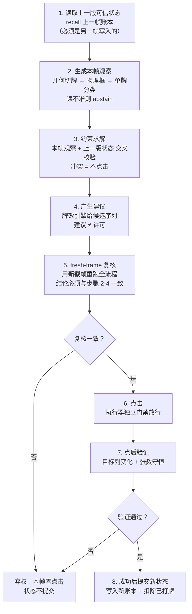
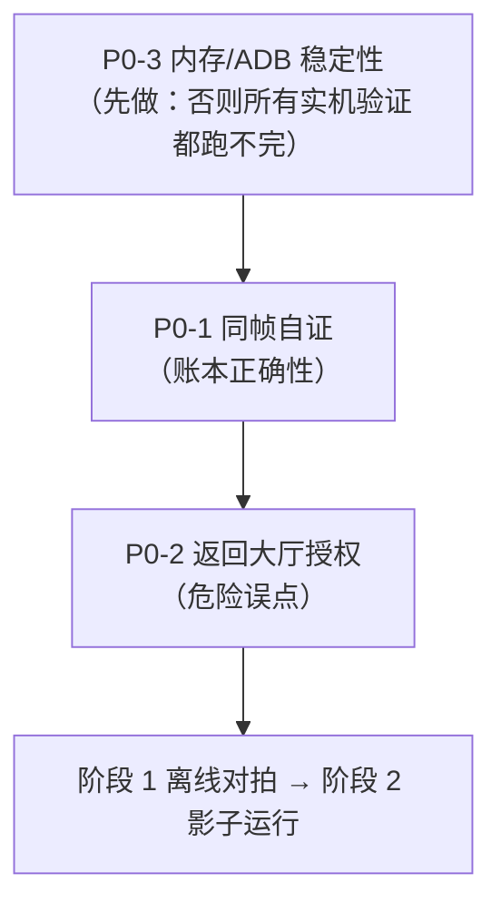

# 识牌—决策—执行管线架构决策（ARCH-20261026）

> **一句话结论**：温州茶 2 人麻将的识牌主线**不是端到端 YOLO**，而是
> **「结构化切牌 + 轻量单牌分类 + 事务式状态账本 + 独立点击门禁」**；
> 目标检测只在"几何定位确实失败"的局部作为补充，且永远没有单独的点击权。

| 项目 | 内容 |
|---|---|
| 文档编号 | ARCH-20261026-identify-pipeline-decision |
| 结论来源 | **外部 AI 架构审查**（独立研究报告，非本项目实测） |
| 项目内证据 | 本文档另行标注的实测台账/源码位置（见附录 B） |
| 状态 | **架构决定（目标态）**，**不是**已完成状态 |
| 撰写时间 | 2026-10-26 09:14（代码快照） |
| 适用范围 | 温州茶 2 人 / 茶 4 人 / 熟 4 人 的**识牌骨架** |

> **阅读须知**：本文件是"我们决定怎么做"，不是"我们已经做到了什么"。
> 文中每一个"已实现 / 部分实现 / 未实现"标注都以 2026-10-26 09:14 的源码快照为准；
> 任何人不得引用本文件宣称"识牌已达标"或"可以无人值守"。

---

## 1. 决策与适用范围

### 1.1 核心结论

固定游戏界面（摄像机视角固定、牌框位置固定、分辨率固定）下，
**"牌在哪里"是几何问题，不是检测问题**。
因此本项目的识牌主线是：

```
画面/ROI 配准 → 几何切牌（固定 ROI + 物理框切分） → 单牌轻量分类
             → 事务式状态账本（跨帧真相） → 独立点击门禁 → 执行 + 点后验证
```

目标检测（YOLO 类）不作为主线，理由见 §7。

### 1.2 适用范围

| 范围 | 说明 |
|---|---|
| **温州茶 2 人**（当前主战场） | 全部适用。当前活动源码在 `温州茶（传统麻将）\bot\`。 |
| **茶 4 人 / 熟 4 人** | **共用识牌骨架**（切牌 + 单牌分类 + 账本 + 门禁四层结构共用）。 |
| **规则层** | **不共用**。牌效、番种、财神规则、吃碰杠胡判定分别做，不共用一套引擎参数。 |
| **验收层** | **不共用**。三种玩法各自的整手正确率、覆盖率、误点数分别标定。 |
| **游戏种类迁移** | 骨架可迁移，但**每一款游戏都要重新做 ROI 标定 + 独立测试集 + 重新过一遍 §6 的阶段门禁**，不许继承上一款游戏的验收结论。 |

---

## 2. 四层职责边界（最重要）

四层**严格单向依赖**：执行器 ← 状态机 ← 视觉 ← 模型（模型只做候选补充）。
**任何一层不得越权替另一层做决定。**

| 层 | 职责（负责什么） | 输出 | **明确禁止（不得越权）** |
|---|---|---|---|
| **① 状态机（账本）**<br>`hand_ledger.py` | 维护"**现在真实有哪些牌**"这一唯一真相。<br>只接受**另一帧**写入的可信读数；跨帧做事务式提交。 | `HandMemory`（手牌 + 副露 + 财神 + 来源帧） | ❌ 不得判定"本帧看到了什么"<br>❌ 不得参与点击许可判定<br>❌ 不得猜牌面、不得放宽阈值<br>❌ **不得把本帧写入的读数当作本帧的证据**（同帧自证） |
| **② 视觉**<br>`tile_vision.py` / `single_bright_cut.py` / `caishen_vision.py` | 回答"**本帧看到了什么**"。<br>几何切牌 → 物理框 → 单牌分类 → 渲染态判定。 | 本帧观察：物理框位置、单牌候选、渲染态、白名单 | ❌ 不得读取或修改账本<br>❌ 不得输出"可以点"<br>❌ 不得用上一帧结果补全本帧<br>❌ 读不准必须 `abstain`，不得降级猜测 |
| **③ 模型**<br>（暂未引入；未来若引入） | 提供"**补充牌面候选**"。<br>仅在几何定位失败的区域给候选，供视觉层交叉验证。 | 候选牌面 + 置信度 | ❌ **输出永远不是点击许可**（红线）<br>❌ 不得直接接执行器<br>❌ 不得绕过账本直接改状态<br>❌ 未做置信度校准前不得上线 |
| **④ 执行器（点击门禁）**<br>`tap_executor.py` | 证明"**现在确实可以点**"。<br>几何白名单 + 点击前重截屏 + 按牌面 id 重定位 + 两段确认 + 点后验证。 | 点击结果 + 证据落盘，或 `TapRejected`/`TapUnverified` 拒绝 | ❌ 不得接收"建议"以外的放行指令<br>❌ 不得用旧帧坐标直接点<br>❌ 不得跳过点后验证<br>❌ 不得自行决定点 gameplay 之外的按钮 |

### 2.1 越权判定清单（评审时用）

以下任一情形出现即判为**架构越权**，必须打回：

1. 视觉层函数里出现 `hand_ledger` / `recall` / `memory` 字样 → ② 越权到 ①。
2. 账本里出现 `clickable` / `allow_tap` 字段 → ① 越权到 ④。
3. 模型输出被直接送进 `tap_executor` 而未经账本与门禁 → ③④ 越权。
4. 执行器依据"建议牌 id"以外的任何信号（如账本手牌、模型置信度）放行 → ④ 越权到 ①③。
5. 循环编排（`auto_play_loop.py`）自己下点击判定，绕过 `tap_executor` → 编排层越权到 ④。

---

## 3. 事务式状态提交顺序

### 3.1 有序流程（不得跳步、不得重排）



### 3.2 绝对禁止项

> **禁止：先把本帧写进账本，再用这个账本证明本帧正确。**

这条是**同帧自证**（循环论证）。一旦发生，账本的三条硬约束
（同局同财神 / 张数相等 / 白名单是子集合）会因"自我一致"而**必然通过**，
于是三道校验同时失效——校验还在，但已经不具备任何证伪能力。

### 3.3 项目内证据（实锤）

| 证据项 | 实测结果 |
|---|---|
| 台账位置 | `_takeover/wb_live/w9/**/actions.jsonl` |
| 特征字段 | `ledger_advice.memory_frame`（账本读数来源帧） vs 同行 `frame`（当前帧） |
| 实测命中 | **共 8 条记录两者完全相同**<br>• `emulator-5556_20261025_235242_g1`：2 条<br>• `emulator-5558_20261025_235242_g1`：6 条<br>• `emulator-5558_20261026_003543_g2`：0 条 |
| 代码路径 | `auto_play_loop.py` 中 `remember(frame=当前帧)` → 同一帧内 `recall()` → 产出 `memory_frame` |
| 后果 | 该 8 条账本辅助建议中，账本**不含任何本帧之外的独立信息**，只是本帧残读的复读 |

> **口径说明**：既有代码注释（`tests/test_auto_play_loop.py:2127`）记为"4 次"。
> 本次按 `memory_frame` 与 `frame` 逐条全量比对实测为 **8 条**。
> 本文件以实测为准，差异供后续核对，不影响结论方向。

### 3.4 落地状态

| 项 | 状态 |
|---|---|
| `hand_ledger.recall(..., current_frame=...)` 帧判据 | **部分实现**（`same_frame` / `unknown_frame` 拒绝已写入生产代码，**未经实机验证**） |
| 循环侧把当前帧传入 `recall` | **部分实现**（已接线，未经实机验证） |
| fresh-frame 复核（步骤 5） | **部分实现**（见 §8：`tap_executor` 有"点击前重截屏 + 按牌面 id 重定位"，但复核范围是建议牌本身，不是整手状态） |
| 点后验证（步骤 7） | **已实现**（两段确认 + 张数守恒 + 证据落盘） |
| 完整八步事务链 | **未实现** |

---

## 4. 单牌三字段模型

每一张牌的判定必须拆成**三个互相独立**的字段，任何一个字段不确定，
都不允许由另外两个字段推断出来。

| 字段 | 含义 | 取值 | 判定依据 |
|---|---|---|---|
| `tile_identity` | 牌面身份（这张是什么牌） | 牌 id / `unknown` | 单牌分类 + 独立判据（如点数计数） |
| `render_state` | **渲染状态**（是**渲染态**，**不是**新牌类） | `normal` / `dim` / `gold` / `badge` / `occluded` | 亮度、饱和度、遮挡覆盖、角标 |
| `clickable` | 本帧是否允许点击 | `true` / `false` | **只由执行器门禁判定**，与身份、渲染态无直接推导关系 |

### 4.1 三条硬规则

1. **`render_state` 不是牌类**。`gold`（金色财神）不是第 35 种牌，
   `dim`（压暗）也不是。渲染态变了，牌的身份不变；渲染态不得参与身份分类。
2. **金色财神完全遮住牌面时，只能靠"已确认财神 + 历史状态"推断，绝不猜**。
   遮住就是遮住：此时 `tile_identity = unknown`、`clickable = false`，
   账本里有这张牌时按账本走，账本里没有就**弃权**，不许用"最像的那张"顶上。
3. **三者必须独立判定**。
   - `clickable=true` **不能**由 `tile_identity` 已知推出；
   - `tile_identity` 已知 **不能**由 `clickable=true` 反推；
   - `render_state=occluded` 时前两者都必须判 `unknown`，不得互相借用。

### 4.2 落地状态

| 字段 | 状态 | 现有支撑 |
|---|---|---|
| `tile_identity` | **部分实现** | `tile_vision.py` 模板分类；`pip_discriminator.py` 对**筒牌 1-9 点**提供独立点数判据（条/万/字牌**不覆盖**） |
| `render_state` | **部分实现** | `single_bright_cut.py` 有压暗/亮牌判定；`caishen_vision.py` 读固定财神位。**未统一成三字段枚举** |
| `clickable` | **部分实现** | `tap_executor.py` 四道闸；但不是独立字段，且与身份判定耦合在同一调用链里 |
| 三字段解耦 | **未实现** | — |

---

## 5. 对抗性风险表

| # | 最坏情况 | 纯 YOLO 会怎么错 | 本方案怎么兜 |
|---|---|---|---|
| 1 | **整块金色遮挡**（财神/特效整块盖住牌面） | 检测框还在、分类照出结果 → **高置信读出一张并不存在的牌** | `render_state=occluded` → `tile_identity=unknown`，只走"已确认财神 + 账本历史"；账本无记录则弃权，绝不猜 |
| 2 | **整手压暗，只亮可打牌** | 把暗牌也能"识别"出来 → 用**幻觉手牌**算牌效，打出游戏不允许的牌 | 暗区一律 `unknown`，不接受"暗牌识别"；亮牌白名单只作**可打范围**，候选取自账本手牌 ∩ 白名单 |
| 3 | **相似牌高置信误判**（四筒/五筒，模板相似度差 0.0123） | 端到端模型同样高置信、且**无法解释为什么** → 静默打错 | 用**独立物理判据**交叉验证（`pip_discriminator` 直接数圆点 + 排布校验）；两条证据链共用预处理会一起被骗，故刻意不互相 import |
| 4 | **账本漏一次摸打后持续污染** | 与检测无关，YOLO 不解决 → 每次刷新都读到"上一次的真相" | 打出后立即 `forget_tile` 精确扣减；扣不准直接清空账本；换局/换局嫌疑一律 `reset`；**账本只接受另一帧写入**（同帧自证拒绝） |
| 5 | **相邻帧随机拆分导致测试虚高** | 训练/测试用了同一段录像的相邻帧 → 离线指标虚高，上线即崩 | 数据集按**整场 / 日期 / 设备**分组划分，相邻录像帧绝不跨组 |
| 6 | 跨局账本残留（上局手牌张数碰巧与新局相同） | 不涉及 | 换局强制 `reset()`，只清不留 |
| 7 | 进程崩溃后状态未知（OOM / ADB 超时） | 不涉及 | 崩溃一律停手留证，不自动重启决策链；见 §9 P0-3 |

---

## 6. 验收指标与升级门禁

### 6.1 指标定义（七个都要报，不许只报单牌准确率）

| 指标 | 定义 | 为什么必须有 |
|---|---|---|
| **物理框召回率** | 手牌物理框被正确定位的比例 | 定位漏一个，后面全错；是"能不能找到牌"的直接度量 |
| **单牌准确率** | 单张牌面判对的比例 | **不够**：见下方 0.995^14 陷阱 |
| **整手完全正确率** | 整手 N 张**全对**的比例 | 真正决定能不能自动点击的指标 |
| **自动动作覆盖率** | 有动作窗口时真正放行的比例 | 防止"靠疯狂弃权刷高准确率" |
| **危险误点数** | 点到 gameplay 之外控件的次数 | **一票否决项** |
| **p95 延迟** | 单帧管线处理耗时 95 分位 | 超过出牌倒计时就必然超时 |
| **持续内存** | 长跑 RSS / commit 曲线 | 内存持续增长 = 存在未定位泄漏，不许升级 |

### 6.2 0.995^14 陷阱（必须写进每一份验收报告）

即使单牌准确率高达 **99.5%**，14 张整手全对也只有：

```
0.995^14 ≈ 0.932  →  93.2%
```

即**每 15 手就有 1 手整手不全对**。
推论（验收红线）：

1. **不许只报单牌准确率**（单看 99.5% 会误以为接近完美）。
2. **不许把"23 次放行点击全部验证成功"说成"识牌 100%"**。
   项目内实测：`_takeover/wb_live/w9` 三个会话共 23 条 `event="action"` 台账记录
   （5556-g1 11 条 + 5558-g1 12 条 + 5558-g2 0 条），23 条均 `verified=true`。
   这证明"点击后验证通过"，**不证明**"牌面识别正确"——
   点后验证的口径是目标列变化 + 张数守恒，与牌面身份正确与否是两件事。
3. 网络输出置信度 ≠ 真实正确率（**过度自信问题**，见 ICML 2017 置信度校准研究）。
   必须用**独立测试集**做校准；冲突时不点击。

### 6.3 阶段门禁（顺序不得跳过）


| 阶段 | 内容 | 准入条件 |
|---|---|---|
| 1 离线对拍 | 帧语料上跑全管线，与人工金标对拍 | 独立测试集已按整场/日期/设备分组建好 |
| 2 影子运行 | 真实设备在线跑，**零点击**，只出建议与指标 | 阶段 1 指标达标 |
| 3 单端有限动作 | 单台设备、有限动作集、人工在场 | 阶段 2 指标达标 + 无危险误点 |
| 4 完整单局 | 打完一整局 | 阶段 3 通过 |
| 5 跨局 | 连续多局，含换局/结算/离桌 | 阶段 4 通过 |
| 6 16 局零人工 | 最终验收 | 阶段 5 通过 + 内存曲线平稳 |

### 6.4 一票否决条件

> **任一阶段出现下列任一情形，不得升级到下一阶段**，必须回到缺陷分析：

1. 出现**危险误点**（点到 gameplay 之外控件，含充值/开始/结算/返回大厅类的未授权点击）。
2. **持续内存持续增长**（曲线单调上升，未收敛）。

---

## 7. YOLO 的启用条件

### 7.1 为什么不作为主线

| 依据来源 | 内容要点 |
|---|---|
| **MaaFramework Pipeline 文档** | 目标检测适合"位置任意"的目标，但相比分类需要**更复杂的模型、更多的训练数据、更高的推理资源**。固定界面里位置**不任意**，这个代价是白付的。 |
| **AutoMajsoul** | 走的是"画面配准 → 几何分割 → TileNet 单牌分类 → BoardState 状态维护"，即本文四层结构的原型。 |
| **Mahjong-YOLO** | 在**真实照片**上自报：精确率 81.2% / 召回 83.2% / 牌类准确率 95.8%。<br>**注：上述准确率是该项目的自报数字，未在温州麻将上独立验证。**<br>即便照抄这个水平，也只够做演示，离自动点击很远。 |

对照 §6.2 的 0.995^14 陷阱：81.2% 精确率量级的检测器，
整手完全正确率会低到无法支撑自动点击。

### 7.2 启用条件（全部满足才可试）

1. **错误分析证明主要矛盾是"找不到牌框"**——
   即失败样本里占比最高的是"物理框漏检/定位漂移"，
   而**不是**压暗、遮挡、相似牌混淆。
   （若主要矛盾是后三者，YOLO 解决不了，不许上。）
2. **限定区域**：只在**副露 / 牌河 / 布局变化区域**试点，不许替换手牌主线。
3. **永远先影子运行**：先在阶段 2（零点击）跑够指标，再谈别的。
4. **永远不给单独点击权**：YOLO 输出只能作为**候选**进入视觉层，
   与几何切牌结果交叉验证；单独一条模型结论**不得**放行点击。
5. **必须先做置信度校准**（独立测试集），未校准不得上线。

### 7.3 落地状态

| 项 | 状态 |
|---|---|
| YOLO / 端到端检测 | **未实现**（按本决策，**暂不启用**） |
| 错误分析（按失败类型归因） | **未实现** |
| 置信度校准 | **未实现** |
| 数据集分组划分 | **未实现** |

---

## 8. 与现有代码的映射表

代码位置均以 `温州茶（传统麻将）\bot\` 为根。
状态为 **2026-10-26 09:14** 快照。

| 架构概念 | 现有文件 | 当前扮演的角色 | 状态 |
|---|---|---|---|
| 事务式状态账本 | `hand_ledger.py` | 同局手牌账本，只接受 `advise`/`hu` 可信读数；`recall` 有同局/同财神/同张数/白名单子集四条件 + 帧判据 | **部分实现** |
| 几何切牌 + 单牌分类 | `tile_vision.py` | 固定 ROI 切牌 + 保守的彩色模板分类；34 标签词表 | **已实现** |
| 相似牌独立裁决 | `pip_discriminator.py` | 筒牌 1-9 点的独立物理判据（数圆点 + 排布校验），刻意不 import `tile_vision` | **部分实现**（仅筒牌） |
| 财神读取 | `caishen_vision.py` | 固定位置红色财神模板读取；遮挡/尺寸异常返回无标签 | **已实现** |
| 渲染态判定（三字段之 `render_state`） | `single_bright_cut.py` + `caishen_vision.py` | 压暗/亮牌判定、财神位读取；**未统一成 `normal/dim/gold/badge/occluded` 枚举** | **部分实现** |
| 压暗帧补偿 | `hand_ledger.py` + `single_bright_cut.py` | 账本读数 + 亮牌白名单决策 | **部分实现** |
| 点击门禁 | `tap_executor.py` | 四道闸：dry_run 默认 / 几何白名单 / 点击前重截屏 / 两段确认 + 点后验证 | **已实现** |
| 循环编排 | `auto_play_loop.py` | 逐帧：抓图 → 分析 → 账本 → 建议 → 点击 → 验证 → 落台账 | **部分实现**（缺独立事务层） |
| 决策/牌效 | `tea_bot.py` / `action_policy.py` | 建议生成（属于第 ④ 步"产生建议"，**不是**许可） | **已实现** |
| 监督（只读） | `session_watch.py` | 只观察、只统计、只出 dry-run 计划；不碰 ADB、不发点击 | **已实现** |
| 设备/进程治理 | `adb_runtime.py` | adb 可执行文件与 server 的单点治理（只读优先） | **部分实现**（模块已建并接入，未实机验证） |
| 内存看门狗 | `mem_guard.py` | 进程内存自我体检开关（带迟滞） | **未实现**（模块已建，**接线进行中**） |
| 模型层（YOLO 等） | — | — | **未实现**（按 §7 暂不启用） |
| 置信度校准 | — | — | **未实现** |
| 数据集分组划分 | — | — | **未实现** |
| 三字段解耦 | 分散在以上文件 | — | **未实现** |
| 八步事务链 | — | — | **未实现** |

### 8.1 统计

| 状态 | 数量 | 项 |
|---|---|---|
| **已实现** | **5** | 几何切牌 + 单牌分类（`tile_vision`）、财神读取（`caishen_vision`）、点击门禁（`tap_executor`）、牌效决策（`tea_bot`/`action_policy`）、只读监督（`session_watch`） |
| **部分实现** | **6** | 事务账本（`hand_ledger`）、相似牌裁决（`pip_discriminator`）、渲染态判定（`single_bright_cut` + `caishen_vision`）、压暗补偿、循环编排（`auto_play_loop`）、设备治理（`adb_runtime`） |
| **未实现** | **6** | 内存看门狗（`mem_guard`，**接线进行中**）、模型层（YOLO）、置信度校准、数据集分组划分、三字段解耦、八步事务链 |

---

## 9. 三个 P0 阻塞项与修复顺序

> 三个 P0 **全部处于"正在修"**。本节如实记录 2026-10-26 09:14 的实际状态，
> 以及"修到什么程度才允许往下走"的门槛。

### 9.1 P0-1：同帧账本自证 —— **正在修**

| 项 | 内容 |
|---|---|
| 现象 | 账本读数来源帧 == 当前帧，账本退化为"本帧残读的复读机"，三条硬约束自我一致而必然通过 |
| 证据 | `_takeover/wb_live/w9` 台账 8 条 `ledger_advice.memory_frame == frame` |
| 当前状态 | **部分实现**：`hand_ledger.recall` 已加 `current_frame` 参数与 `same_frame` / `unknown_frame` 两种 fail-closed 拒绝；循环侧已传入当前帧 |
| 还差什么 | **实机验证尚未做**。未在新会话台账里复验"命中 8 条的场景现在会正确弃权"之前，不得标记完成 |

### 9.2 P0-2：未经授权的自动返回大厅 —— **正在修**

| 项 | 内容 |
|---|---|
| 现象 | 牌局结束时程序自动点「返回大厅」，把用户带离牌桌；离桌后跨帧状态一次性作废，不可回滚 |
| 当前状态 | **部分实现**：`allow_return_lobby` 授权门已落地，默认 `False`，只接受真布尔值（字符串/环境变量/配置无法打开），未授权时本帧零点击并停手留证；已有对应测试 |
| 还差什么 | **实机验证尚未做**。需在真实"局数打满"画面上确认：未授权时零点击、已授权时点一次并验证版式消失 |

### 9.3 P0-3：OpenCV 内存不足 / ADB 长跑异常 —— **正在修**

#### 9.3-a OpenCV 内存不足

| 项 | 内容 |
|---|---|
| 实测证据 | `emulator-5558_20261025_235242_g1/actions.jsonl`，2026-10-26T00:35:43<br>`event=stop, gate=unhandled_exception`<br>`OpenCV(4.10.0) ... alloc.cpp:73 error: (-4:Insufficient memory) Failed to allocate 11540008 bytes in function 'cv::OutOfMemoryError'` |
| 已知放大器 | 全量测试与代打**并发**跑时 RSS 被顶到系统上限 |
| 当前状态 | **未实现（模块已建，接线进行中）**：`mem_guard.py` 模块已建成且有 `tests/test_mem_guard.py`；software-engineer **正在接入** `auto_play_loop.py`。接线规格：阈值走环境变量 `WZMJ_RSS_LIMIT_MB`；连续超限**只做** `stop(gate="resource_guard")` 并记实测值；**不做降采样、不自愈**。 |
| 关键认识 | 崩溃点离真正泄漏点很远，事后只能看到"某处 cv2 调用炸了"。看门狗只负责**在踩线时给信号**，**不回收内存、不替代定位真实泄漏点** |
| 门槛 | `limit_mb=1500` 是**初值不是结论**，必须用实测峰值 RSS 重新标定后，才可声称"OOM 已缓解" |

#### 9.3-b ADB 长跑异常（**成因待定**）

| 项 | 内容 |
|---|---|
| **实测证据** | `emulator-5556_20261025_235242_g1`（00:36:51）与 `emulator-5558_20261026_003543_g2`（00:36:50）<br>`event=stop, gate=gate_foreground`<br>`ADB 调用失败: Command ['D:/leidian/LDPlayer14/adb.exe', '-s', ..., 'shell', 'dumpsys', 'window'/'activity', ...] timed out after 15 seconds` |
| **首要真因线索** | **adb 调用超时本身**（`dumpsys` 15 秒未返回）。<br>比起"进程崩溃退出码"，**超时更能直接解释门禁表现**：`gate_foreground` 拿不到 `dumpsys` 结果 → 无法确认前台包名 → fail-closed 停手。**表面像识牌问题，实质是取不到前台证据。** |
| **成因** | **待定，未证实。**<br>早期曾推测为"两套 adb 抢 5037 端口互踢"，**已被两路独立复核否定**（team-lead 与 software-engineer-3 各自独立，结论一致）：<br>• `C:\leidian` 与 `D:\leidian` 下的 adb **字节完全相同**（大小 5,916,440；mtime 2026-10-14 08:41:44；MD5 `F1F479BBA21298E758FC22D8D98F8E48`），字节相同的两份 adb 不会互踢 server；<br>• 复核时全机只有 **1 个** adb 进程（PID 18368）；<br>• `采集/scrcpy/adb.exe` **在磁盘上不存在**。<br>同理，"3221225773（0xC0000005 访问违例）崩溃"也**未证实**由抢端口引起（该描述出自 `adb_runtime.py` 模块头，属推断性背景描述，非实测结论）。 |
| 当前状态 | **部分实现**：已消除 adb 多路径分歧，把"到底用哪个 adb"收敛成唯一一处决策（`adb_runtime.resolve_adb_path()`），已接入 `auto_play_loop` 与 `assist_window`；默认只读、**默认不 kill-server** |
| 还差什么 | **定性取证**（见 §9.3-d）+ 实机验证长跑不再出现 `dumpsys` 超时 |

#### 9.3-c 内存未稳定前的强制约束

> **在内存曲线稳定之前，以下四条为硬约束：**

1. **不得把 PyTorch 加进正式进程**（正式进程 = 代打循环进程）。
2. 实验模型必须放在**独立影子进程**，与主进程通过只读结果通信。
3. 优先**导出 ONNX**，用轻量运行时推理，不引入完整训练框架。
4. 必须设**内存上限 + 熔断**：超限时有序停下并报警，不许被系统 OOM 一刀切。

#### 9.3-d 下次 adb 故障复现的取证要求（三项齐全才能定性）

> 在故障**复现瞬间**同时记录以下三项，缺一项不得对成因下结论：

1. `adb_inventory()['servers']` 列表（当时有几个 adb server、各自的路径与 PID）。
2. **该次 `dumpsys` 的实际耗时**（不是超时上限 15 秒，而是真实耗时分布）。
3. **是否伴随模拟器窗口切换**（窗口切换期 dumpsys 易被拖慢）。

### 9.4 修复顺序（不得颠倒）



**理由**：P0-3 是**验证能力**的前置——内存/ADB 不稳定时，任何实机验证都跑不完，
也就无法证明 P0-1 / P0-2 修好了。P0-1 修的是"说得对不对"，
P0-2 修的是"会不会乱点"，两者都必须在稳定性之后，且必须先于任何阶段门禁。

---

## 10. 本文档的边界声明

1. 本文档是**最佳架构决定**，是**目标态**。
2. 本文档**不是已完成状态**。文中"已实现"仅指对应职责在代码中存在可用实现，
   不等于该职责已被验证达标。
3. **不得**依据本文档宣称：
   - "识牌已达标"
   - "可以无人值守"
   - "16 局零人工已通过"
   - "识牌 100%"
4. 外部依据中的准确率数字（Mahjong-YOLO 等）为**对方项目自报**，
   **未在温州麻将上独立验证**，引用时必须保留此限定。
5. 本文档**不改动任何代码、不改动 `开发档案.md`**。
   所有"状态标注"随代码演进会失效，引用时须核对快照时间（2026-10-26 09:14）。

---

## 附录 A：外部依据清单（含可信度标注）

| 来源 | 引用的结论 | 可信度标注 |
|---|---|---|
| **AutoMajsoul** | 管线为"画面配准 → 几何分割 → TileNet 单牌分类 → BoardState 状态维护" | 架构路线参考。本项目未对其实现做独立验证。 |
| **MaaFramework Pipeline 文档** | 目标检测适合位置任意的目标；相比分类需要更复杂模型、更多训练数据、更高推理资源 | 文档表述，与本项目固定界面前提一致。 |
| **Mahjong-YOLO** | 真实照片上自报：精确率 81.2% / 召回 83.2% / 牌类准确率 95.8% | **该准确率为项目自报，未在温州麻将上独立验证。** 仅用于说明"够演示、离自动点击很远"。 |
| **ICML 2017 置信度校准**（Guo et al., *On Calibration of Modern Neural Networks*） | 现代网络存在过度自信：输出置信度 ≠ 真实正确率 | 学术结论。本项目**尚未做任何校准**。 |
| **Ultralytics 数据集划分** | 数据集划分需按整段/场景分组，避免相邻帧泄漏 | 工程规范。本项目**尚未建立分组测试集**。 |
| **外部 AI 架构审查（本研究）** | 固定界面的最佳路线是"结构化切牌 + 轻量单牌分类 + 事务式状态账本 + 独立点击门禁"，YOLO 仅作补充 | **结论来源为外部 AI 独立审查**，非本项目实测。项目内实测证据另见附录 B。 |

## 附录 B：项目内实测证据索引

| # | 证据 | 位置 | 用在本文件 |
|---|---|---|---|
| B-1 | 同帧账本自证 8 条 | `_takeover/wb_live/w9/emulator-5556_20261025_235242_g1/actions.jsonl`（2 条）<br>`_takeover/wb_live/w9/emulator-5558_20261025_235242_g1/actions.jsonl`（6 条）<br>字段：`ledger_advice.memory_frame` vs `frame` | §3.3 |
| B-2 | 23 次放行点击全部 verified | 同上三文件，`event="action"` 计数 11 + 12 + 0 = 23，全部 `verified=true` | §6.2（反例：不能说成识牌 100%） |
| B-3 | OpenCV OOM 崩溃 | `emulator-5558_20261025_235242_g1/actions.jsonl`，2026-10-26T00:35:43<br>`(-4:Insufficient memory) Failed to allocate 11540008 bytes` | §9.3-a |
| B-4 | **ADB dumpsys 超时（双端）—— 首要真因线索** | `emulator-5556_.../actions.jsonl` 00:36:51（`dumpsys window windows`）<br>`emulator-5558_20261026_003543_g2/actions.jsonl` 00:36:50（`dumpsys activity activities`）<br>均 `timed out after 15 seconds`，路径 `D:/leidian/LDPlayer14/adb.exe`<br>**处置要求：下次复现时同时记录 ①`adb_inventory()['servers']` ②该次 dumpsys 的实际耗时 ③是否伴随模拟器窗口切换——三者齐了才能定性** | §9.3-b、§9.3-d |
| B-5 | **早期"两套 adb 抢 5037"推断已被否定** | 出处为 `bot/adb_runtime.py` 模块头（**推断性背景描述，非实测**）。<br>两路独立复核（team-lead、software-engineer-3）一致否定：<br>• `C:\leidian` 与 `D:\leidian` 下 adb **字节完全相同**（大小 5,916,440；mtime 2026-10-14 08:41:44；MD5 `F1F479BBA21298E758FC22D8D98F8E48`）<br>• 复核时全机仅 **1 个** adb 进程（PID 18368）<br>• `采集/scrcpy/adb.exe` **在磁盘上不存在** | §9.3-b（反证） |
| B-6 | 筒牌 4/5 模板相似度仅差 0.0123 | `bot/pip_discriminator.py` 模块头记载（原文自称实测，**本次未独立复算**） | §5 风险 3 |
| B-7 | 压暗态暗牌亮度 p70=100（正常 214） | `bot/hand_ledger.py` 模块头记载（原文自称实测，**本次未独立复算**） | §5 风险 2 |
| B-8 | 停机报告 | `_takeover/wb_live/w9/halted_report.md` | §9.3 佐证 |

### B-9 证据分级规则（本附录的引用纪律）

> B-5 的教训必须固化成规则：**模块头文档字符串 ≠ 实测结论。**

| 级别 | 定义 | 本附录中的项 |
|---|---|---|
| **一级：原始台账** | 直接从 `actions.jsonl` 等运行时记录逐条解析得出，可复算 | B-1、B-2、B-3、B-4、B-8 |
| **二级：模块头记载** | 写在源码 docstring 里、原文自称"实测"但**未经本次独立复算** | B-6、B-7 |
| **三级：推断性描述** | 写在 docstring 里但**本质是推测**，必须显式标注为推断 | B-5（原为三级却按结论引用，**已订正**） |

引用纪律：

1. 三级描述**一律不得**当作根因或结论写入决策文档；只能作为"待验证假设"。
2. 二级描述引用时必须带"**原文自称实测，本次未独立复算**"。
3. **外部结论里的数字也要按项目内一级证据订正**——B-1 的"8 条 vs 4 条"正是按此处理的。

---

*文档结束。本文件只写文档，未改动任何 `.py` 文件，未改动 `开发档案.md`。*
